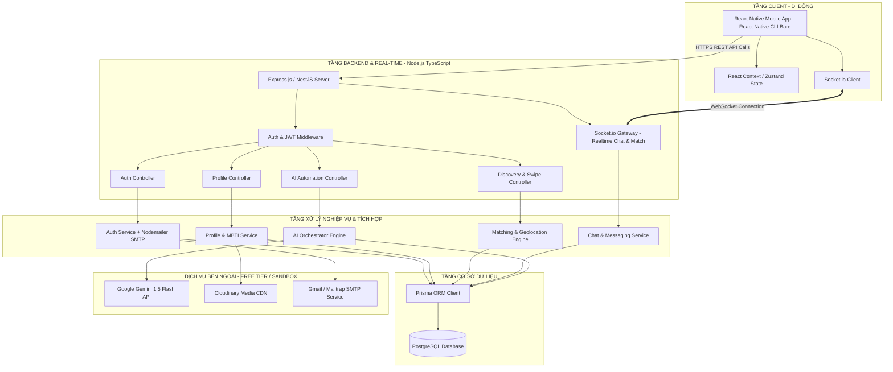
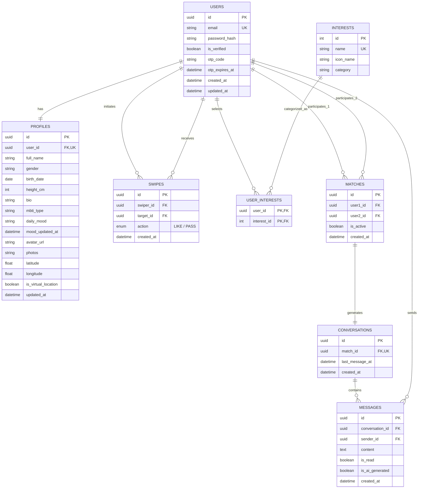

# THIẾT KẾ KIẾN TRÚC HỆ THỐNG VÀ CƠ SỞ DỮ LIỆU (SYSTEM ARCHITECTURE & DATABASE DESIGN)
## DỰ ÁN: SMART DATING APP (CUPID AI)
**Phiên bản:** 1.0 (Official Technical Design)  
**Tác giả:** Senior Solution Architect & Database Engineer  

---

## 1. TỔNG QUAN KIẾN TRÚC HỆ THỐNG (SYSTEM ARCHITECTURE)

Hệ thống được thiết kế theo mô hình **Monolithic phân tầng hướng dịch vụ (Clean Layered Architecture)** nhằm đảm bảo tính toàn vẹn của một đồ án kỹ thuật phần mềm chuẩn mực: Dễ triển khai, dễ theo dõi, kiểm soát 100% mã nguồn và tách biệt rành mạch giữa các tầng Controller, Service, Repository và Socket Gateway.

### 1.1. Sơ đồ Kiến trúc Tổng thể (Mermaid Diagram)



---

## 2. THIẾT KẾ CƠ SỞ DỮ LIỆU QUAN HỆ (POSTGRESQL & PRISMA ORM)

### 2.1. Sơ đồ Thực thể Liên kết (Entity-Relationship Diagram - ERD)



---

### 2.2. Mã nguồn Lược đồ Prisma (`schema.prisma`)
Mã nguồn này sẵn sàng đưa trực tiếp vào dự án Backend để chạy `npx prisma migrate dev`:

```prisma
datasource db {
  provider = "postgresql"
  url      = env("DATABASE_URL")
}

generator client {
  provider = "prisma-client-js"
}

enum SwipeAction {
  LIKE
  PASS
}

enum Gender {
  MALE
  FEMALE
  OTHER
}

model User {
  id              String         @id @default(uuid())
  email           String         @unique
  passwordHash    String         @map("password_hash")
  isVerified      Boolean        @default(false) @map("is_verified")
  otpCode         String?        @map("otp_code")
  otpExpiresAt    DateTime?      @map("otp_expires_at")
  createdAt       DateTime       @default(now()) @map("created_at")
  updatedAt       DateTime       @updatedAt @map("updated_at")

  profile         Profile?
  interests       UserInterest[]
  swipesSent      Swipe[]        @relation("SwiperUser")
  swipesReceived  Swipe[]        @relation("TargetUser")
  matchesAsUser1  Match[]        @relation("MatchUser1")
  matchesAsUser2  Match[]        @relation("MatchUser2")
  messagesSent    Message[]      @relation("SentMessages")

  @@map("users")
}

model Profile {
  id                String    @id @default(uuid())
  userId            String    @unique @map("user_id")
  user              User      @relation(fields: [userId], references: [id], onDelete: Cascade)
  fullName          String    @map("full_name")
  gender            Gender
  birthDate         DateTime  @map("birth_date")
  heightCm          Int?      @map("height_cm")
  bio               String?   @db.Text
  mbtiType          String?   @map("mbti_type") // ENFP, INTJ, etc.
  dailyMood         String?   @map("daily_mood") // "Thèm trà sữa", "Cần người đi dạo", etc.
  moodUpdatedAt     DateTime? @map("mood_updated_at")
  avatarUrl         String?   @map("avatar_url")
  photos            String[]  @default([]) // URLs to Cloudinary
  latitude          Float     @default(21.028511) // Default to Hanoi coordinate
  longitude         Float     @default(105.854444)
  isVirtualLocation Boolean   @default(false) @map("is_virtual_location")
  maxDistanceKm     Int       @default(50) @map("max_distance_km")
  ageMin            Int       @default(18) @map("age_min")
  ageMax            Int       @default(35) @map("age_max")
  updatedAt         DateTime  @updatedAt @map("updated_at")

  @@map("profiles")
}

model Interest {
  id        Int            @id @default(autoincrement())
  name      String         @unique
  iconName  String?        @map("icon_name")
  category  String?
  users     UserInterest[]

  @@map("interests")
}

model UserInterest {
  userId     String   @map("user_id")
  interestId Int      @map("interest_id")
  user       User     @relation(fields: [userId], references: [id], onDelete: Cascade)
  interest   Interest @relation(fields: [interestId], references: [id], onDelete: Cascade)

  @@id([userId, interestId])
  @@map("user_interests")
}

model Swipe {
  id        String      @id @default(uuid())
  swiperId  String      @map("swiper_id")
  targetId  String      @map("target_id")
  action    SwipeAction
  createdAt DateTime    @default(now()) @map("created_at")

  swiper    User        @relation("SwiperUser", fields: [swiperId], references: [id], onDelete: Cascade)
  target    User        @relation("TargetUser", fields: [targetId], references: [id], onDelete: Cascade)

  @@unique([swiperId, targetId])
  @@index([swiperId])
  @@index([targetId])
  @@map("swipes")
}

model Match {
  id           String        @id @default(uuid())
  user1Id      String        @map("user1_id")
  user2Id      String        @map("user2_id")
  isActive     Boolean       @default(true) @map("is_active")
  createdAt    DateTime      @default(now()) @map("created_at")

  user1        User          @relation("MatchUser1", fields: [user1Id], references: [id], onDelete: Cascade)
  user2        User          @relation("MatchUser2", fields: [user2Id], references: [id], onDelete: Cascade)
  conversation Conversation?

  @@unique([user1Id, user2Id])
  @@map("matches")
}

model Conversation {
  id            String    @id @default(uuid())
  matchId       String    @unique @map("match_id")
  match         Match     @relation(fields: [matchId], references: [id], onDelete: Cascade)
  lastMessageAt DateTime  @default(now()) @map("last_message_at")
  createdAt     DateTime  @default(now()) @map("created_at")
  messages      Message[]

  @@map("conversations")
}

model Message {
  id             String       @id @default(uuid())
  conversationId String       @map("conversation_id")
  conversation   Conversation @relation(fields: [conversationId], references: [id], onDelete: Cascade)
  senderId       String       @map("sender_id")
  sender         User         @relation("SentMessages", fields: [senderId], references: [id], onDelete: Cascade)
  content        String       @db.Text
  isRead         Boolean      @default(false) @map("is_read")
  isAiGenerated  Boolean      @default(false) @map("is_ai_generated")
  createdAt      DateTime     @default(now()) @map("created_at")

  @@index([conversationId, createdAt])
  @@map("messages")
}
```

---

## 3. ĐẶC TẢ HỢP ĐỒNG API (RESTFUL API SPECIFICATION)

### 3.1. Nhóm Xác thực (Authentication)
* `POST /api/v1/auth/register`
  * **Input:** `{ email: string, password: string }`
  * **Logic:** Kiểm tra email tồn tại -> Tạo user (`is_verified = false`) -> Tạo mã OTP 6 số -> Gửi email.
  * **Output (201):** `{ message: "Mã OTP đã được gửi về email của bạn.", email: string }`
* `POST /api/v1/auth/verify-otp`
  * **Input:** `{ email: string, otpCode: string }`
  * **Logic:** So khớp OTP và kiểm tra hạn sử dụng. Kích hoạt tài khoản -> Cấp phát JWT.
  * **Output (200):** `{ accessToken: string, refreshToken: string, user: { id, email, hasProfile: boolean } }`
* `POST /api/v1/auth/login`
  * **Input:** `{ email: string, password: string }`
  * **Output (200):** `{ accessToken: string, refreshToken: string, user: { id, email, hasProfile: boolean } }`

### 3.2. Nhóm Hồ sơ (Profile & Preferences)
* `POST /api/v1/profile`
  * **Header:** `Authorization: Bearer <token>`
  * **Input:** `{ fullName, gender, birthDate, bio, heightCm, interestIds: number[], photos: string[] }`
  * **Output (201):** `{ profile: ProfileObject }`
* `PUT /api/v1/profile/mbti`
  * **Input:** `{ mbtiType: "INFP" | "INTJ" | ... }`
  * **Output (200):** `{ message: "Cập nhật tính cách MBTI thành công", mbtiType: string }`
* `PUT /api/v1/profile/mood`
  * **Input:** `{ dailyMood: "Thèm trà sữa" }`
  * **Output (200):** `{ message: "Cập nhật tâm trạng thành công", dailyMood: string, expiresAt: string }`
* `PUT /api/v1/profile/location`
  * **Input:** `{ latitude: number, longitude: number, isVirtualLocation: boolean }`
  * **Output (200):** `{ message: "Cập nhật vị trí thành công" }`

### 3.3. Nhóm Khám phá & Vuốt Match (Discovery & Swipe)
* `GET /api/v1/discovery/feed`
  * **Logic:** Tính khoảng cách Haversine từ tọa độ User đến các ứng viên tiềm năng, lọc theo giới tính, tuổi, loại bỏ người đã vuốt.
  * **Output (200):** `[ { id, fullName, age, bio, mbtiType, dailyMood, distanceKm, photos: [], interests: [] } ]`
* `POST /api/v1/swipes`
  * **Input:** `{ targetUserId: string, action: "LIKE" | "PASS" }`
  * **Logic:** Lưu bản ghi Swipe. Nếu `action == "LIKE"`, kiểm tra ngược xem `targetUserId` đã Like mình chưa. Nếu có -> Tạo `Match` + `Conversation`.
  * **Output (200):** `{ matched: boolean, matchDetails: MatchObject | null }`

### 3.4. Nhóm Trợ lý AI (AI Orchestrator)
* `POST /api/v1/ai/icebreaker`
  * **Input:** `{ matchId: string }`
  * **Logic:** Lấy thông tin Profile của User 1 và User 2 từ DB -> Gọi Google Gemini 1.5 Flash -> Trả về 3 phương án gợi ý mở lời.
  * **Output (200):**
    ```json
    {
      "success": true,
      "commonGround": "Cả hai đều có sở thích Đọc sách và tính cách hướng nội (INFP & INTJ)",
      "icebreakers": [
        {
          "style": "Hài hước",
          "text": "Nghe đồn hai đứa INFP và INTJ gặp nhau thì cả buổi chỉ nhìn nhau cười qua trang sách đúng không bạn? Chào Linh nha!"
        },
        {
          "style": "Tinh tế",
          "text": "Chào Linh, thấy bạn đang để tâm trạng 'Thèm trà sữa' mà lại thích đọc sách, bạn có quán cafe sách nào yên tĩnh tủ ruột không?"
        },
        {
          "style": "Trực diện",
          "text": "Chào bạn! Mình thấy gu đọc sách của hai đứa mình có khá nhiều điểm chung, rất vui được kết nối với bạn!"
        }
      ]
    }
    ```

---

## 4. TỪ ĐIỂN SỰ KIỆN SOCKET.IO (REAL-TIME WEBSOCKET DICTIONARY)

| Tên sự kiện (Event Name) | Chiều (Direction) | Payload dữ liệu | Mục đích nghiệp vụ |
| :--- | :---: | :--- | :--- |
| `join_conversation` | Client -> Server | `{ conversationId: string }` | Client gia nhập phòng chat của cuộc Match tương ứng. |
| `send_message` | Client -> Server | `{ conversationId: string, content: string, isAiGenerated: boolean }` | Người dùng gửi một tin nhắn văn bản vào cuộc trò chuyện. |
| `receive_message` | Server -> Client | `{ messageId, senderId, content, createdAt, isAiGenerated }` | Phát tán tin nhắn mới tới cả hai bên trong phòng chat. |
| `typing_status` | Client -> Server | `{ conversationId: string, isTyping: boolean }` | Thông báo người dùng đang gõ phím. |
| `user_typing` | Server -> Client | `{ userId: string, isTyping: boolean }` | Hiển thị hiệu ứng "đang soạn tin..." trên màn hình đối phương. |
| `match_notification` | Server -> Client | `{ matchId, matchedUser: { id, fullName, avatarUrl } }` | Bắn popup thông báo ghép đôi thành công ngay tức khắc. |
