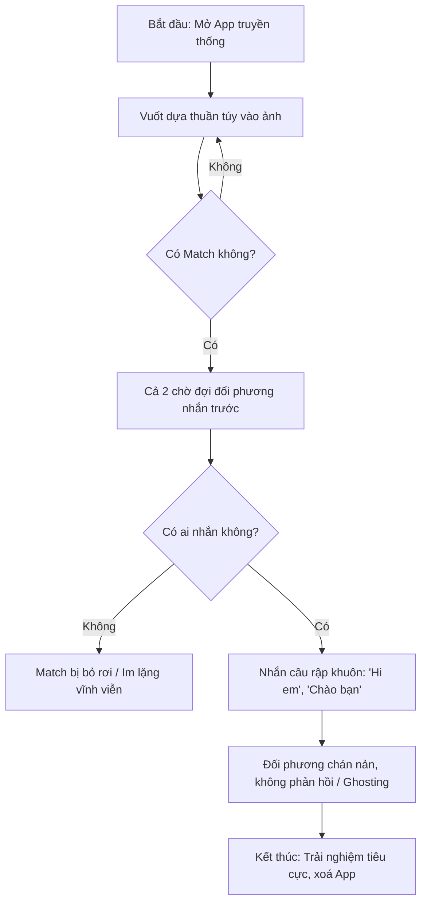
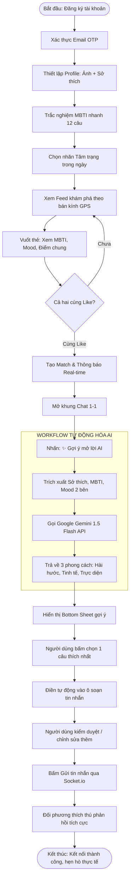

# QUY TRÌNH NGHIỆP VỤ VÀ ĐẶC TẢ WORKFLOW TỰ ĐỘNG HÓA AI
## DỰ ÁN: SMART DATING APP (CUPID AI)
**Phiên bản:** 1.0 (Official Process & AI Specification)  
**Tác giả:** Senior AI Automation Architect & Business Process Engineer  

---

## 1. SO SÁNH QUY TRÌNH NGHIỆP VỤ: AS-IS VS TO-BE

### 1.1. Quy trình Hiện tại (AS-IS) - Nỗi đau của Ứng dụng Hẹn hò Truyền thống
Trong các ứng dụng hẹn hò đại trà hiện nay, hành trình của người dùng diễn ra như sau:
1. **Thiết lập hời hợt:** Người dùng chỉ up vài bức ảnh, bio để trống hoặc viết vài từ vô nghĩa.
2. **Vuốt mù quáng (Passive Swiping):** Vuốt hàng trăm thẻ dựa thuần túy trên ngoại hình trong vài giây.
3. **Hiện tượng Match Ảo & Im lặng:** Khi match thành công, cả hai đều chờ đối phương mở lời trước.
4. **Bế tắc hội thoại (Ghosting):** Nếu có người mở lời, họ thường dùng những câu nhàm chán: *"Chào em", "Hi", "Làm quen nha"*. 80% trường hợp người nhận không buồn trả lời vì câu mở đầu thiếu sáng tạo và không có điểm chung để khai thác.
5. **Thất vọng & Bỏ ứng dụng (Churn):** Người dùng cảm thấy tốn thời gian, thất vọng và xóa app.



---

### 1.2. Quy trình Đề xuất Tương lai (TO-BE) - Ứng dụng Hẹn hò Thông minh (Cupid AI)
Hệ thống giải quyết triệt để sự ngượng ngùng và bế tắc bằng việc bổ sung thông tin tâm lý (MBTI), cảm xúc thời gian thực (Mood tag) và **Trợ lý AI gợi ý câu mở lời (Smart Icebreaker)**:



---

## 2. ĐẶC TẢ CHI TIẾT WORKFLOW TỰ ĐỘNG HÓA AI (AI ICEBREAKER WORKFLOW)
*(Tuân thủ đầy đủ 18 tiêu chuẩn đặc tả giải pháp AI cấp độ doanh nghiệp)*

### 1. Tên Workflow:
* **Smart Contextual Icebreaker Generator** (Mã hiệu: `WF-AI-ICEBREAKER-01`).

### 2. Mục tiêu (Objective):
* Giải quyết rào cản tâm lý e ngại bắt chuyện của người dùng, đặc biệt là nhóm người hướng nội; nâng tỷ lệ chuyển đổi từ Match sang Hội thoại thật (First Message Sent Rate) từ mức 25% lên trên 80%.

### 3. Sự kiện kích hoạt (Trigger):
* Người dùng nhấn vào nút biểu tượng "✨ Gợi ý mở lời AI" (hoặc banner chào đón tương hợp) bên trong màn hình Chat của cuộc Match.

### 4. Tiền điều kiện (Preconditions):
* Cuộc trò chuyện giữa User A và User B đã được xác lập (`Match.isActive == true`).
* Người dùng A đã xác thực và có phiên làm việc JWT hợp lệ.
* Số lượt yêu cầu gợi ý của User A trong ngày chưa vượt quá hạn mức Rate-limit (Tối đa 20 lần/ngày để chống lạm dụng).

### 5. Dữ liệu đầu vào (Inputs):
Hệ thống tự động trích xuất các trường dữ liệu từ PostgreSQL mà không yêu cầu người dùng phải nhập tay:
* **User A (Người gửi):** Tên, Giới tính, Tuổi, Loại MBTI (VD: `INFP`), Danh sách sở thích (VD: `["Đọc sách", "Cà phê", "Nuôi mèo"]`), Mood hiện tại (VD: `Cần người đi dạo`).
* **User B (Người nhận):** Tên, Giới tính, Tuổi, Bio tóm tắt, Loại MBTI (VD: `INTJ`), Danh sách sở thích (VD: `["Đọc sách", "Lập trình", "Du lịch"]`), Mood hiện tại (VD: `Thèm trà sữa`).

### 6. Các bước xử lý tuần tự (Processing Steps):
1. **Bước 1 (Authorize & Rate Limit):** API Gateway kiểm tra tính hợp lệ của token và số lượt gọi trong cache/DB.
2. **Bước 2 (Data Gathering & Intersect):** Backend truy vấn thông tin Profile của User A và B, xác định các điểm giao thoa (Intersection) giữa 2 hồ sơ:
   * Sở thích chung: `["Đọc sách"]`
   * Mối quan hệ MBTI: `INFP` và `INTJ` (Nhóm hướng nội suy nghĩ sâu sắc, bổ trợ cho nhau).
   * Mood đối phương: `"Thèm trà sữa"`.
3. **Bước 3 (Prompt Compilation):** Hệ thống ghép dữ liệu vào System Prompt và User Prompt chuẩn hóa.
4. **Bước 4 (LLM Execution):** Backend gọi Google Gemini 1.5 Flash API qua HTTPS POST với cấu hình `temperature = 0.7`, `response_mime_type = "application/json"`.
5. **Bước 5 (Parsing & Validation):** Backend nhận phản hồi JSON, kiểm tra cấu trúc schema hợp lệ.
6. **Bước 6 (Response Delivery):** Backend gửi mảng 3 câu mở lời về Mobile Client để hiển thị.

### 7. Logic rẽ nhánh và quyết định (Decision Logic):
* **Nếu có sở thích chung:** Ưu tiên tập trung câu mở lời vào chủ đề chung đó.
* **Nếu không có sở thích chung nhưng có Mood tag:** Lấy Mood tag của đối phương làm "cớ" bắt chuyện dí dỏm.
* **Nếu không có cả sở thích chung và Mood tag:** Sử dụng sự đối lập/tương đồng về tính cách MBTI hoặc Bio để tạo lời mở đầu duyên dáng.

### 8. Thành phần AI (AI Component Specification):
* **Model:** Google Gemini 1.5 Flash (`gemini-1.5-flash-latest`) – Được chọn vì tốc độ phản hồi cực nhanh (< 2s), chi phí Free Tier dồi dào (15 Requests/phút) và khả năng xử lý ngôn ngữ tiếng Việt tự nhiên, trẻ trung.
* **System Prompt (Chỉ thị hệ thống):**
  ```text
  Bạn là Cupid AI - Chuyên gia tâm lý tình yêu và cố vấn giao tiếp trên ứng dụng hẹn hò.
  Nhiệm vụ của bạn là phân tích thông tin hồ sơ của Người gửi (User A) và Người nhận (User B) để tạo ra 3 câu mở lời (Icebreakers) bằng Tiếng Việt.
  
  Yêu cầu bắt buộc:
  1. Ngôn từ tự nhiên, trẻ trung, lịch thiệp, không sến súa, không sáo rỗng, tuyệt đối không dùng các câu rập khuôn như "Chào em", "Làm quen nha".
  2. Tận dụng thông minh các điểm chung về sở thích, đặc điểm tính cách MBTI hoặc trạng thái tâm trạng (Mood) của người nhận.
  3. Xuất kết quả DUY NHẤT dưới định dạng JSON theo đúng schema sau:
  {
    "commonGround": "Mô tả ngắn điểm chung",
    "icebreakers": [
      { "style": "Hài hước", "text": "Nội dung câu nói" },
      { "style": "Tinh tế", "text": "Nội dung câu nói" },
      { "style": "Trực diện", "text": "Nội dung câu nói" }
    ]
  }
  ```
* **User Context Payload (Ví dụ):**
  ```json
  {
    "sender": { "name": "Hoàng", "gender": "MALE", "mbti": "INFP", "interests": ["Đọc sách", "Cà phê"], "mood": "Cần người đi dạo" },
    "receiver": { "name": "Linh", "gender": "FEMALE", "mbti": "ENFP", "interests": ["Đọc sách", "Du lịch"], "mood": "Thèm trà sữa", "bio": "Thích những buổi chiều hoàng hôn bên quán quen" }
  }
  ```

### 9. Điểm tích hợp bên ngoài (Integrations):
* Dịch vụ: `@google/genai` (SDK chính thức của Google) hoặc REST API `https://generativelanguage.googleapis.com/v1beta/models/gemini-1.5-flash:generateContent`.

### 10. Cơ chế Con người can thiệp (Human-in-the-loop):
* **Tuyệt đối không tự động gửi tin:** AI chỉ đóng vai trò "gợi ý sáng tạo".
* Khi người dùng nhấn vào thẻ gợi ý, câu văn đó được chuyển thành giá trị của ô nhập liệu (`TextInput`) trên màn hình. Người dùng có toàn quyền:
  * Đọc lại và suy nghĩ.
  * Thêm emoji, sửa đổi xưng hô theo cách riêng.
  * Chỉ khi người dùng chủ động nhấn nút "Gửi", tin nhắn mới được lưu vào CSDL và phát đi qua Socket.io.

### 11. Dữ liệu và Hành động đầu ra (Outputs):
* Định dạng: JSON gồm `commonGround` (chuỗi phân tích) và mảng 3 đối tượng câu mở lời kèm phong cách (`style`).
* Hành động: Mobile hiển thị Bottom Sheet với 3 nút lựa chọn trực quan.

### 12. Xử lý lỗi và Ngoại lệ (Error Handling):
* **HTTP 429 (Rate Limit của Gemini API):** Ghi log cảnh báo và tự động chuyển sang Fallback Engine.
* **HTTP 500 / Timeout (> 4 giây):** Hủy kết nối với Gemini để không bắt người dùng chờ lâu và kích hoạt Fallback.
* **JSON Parsing Error (Model sinh sai định dạng):** Dùng biểu thức chính quy (Regex) trích xuất block JSON hoặc chuyển sang Fallback.

### 13. Phương án Dự phòng (Fallback Mechanism):
* Nếu dịch vụ AI gặp sự cố (mất mạng, hết quota), Backend tự động sinh 3 câu mở lời từ bộ mẫu quy tắc nội bộ (Rule-based templates) dựa trên sở thích đầu tiên của đối phương:
  * *Hài hước:* "Hồ sơ của bạn bảo bạn thích [Sở thích], mình cũng vậy! Liệu đây có phải là dấu hiệu của vũ trụ không nhỉ? Chào [Tên]!"
  * *Tinh tế:* "Chào [Tên], thấy bạn để trạng thái '[Mood]', hôm nay của bạn thế nào rồi?"
  * *Trực diện:* "Chào [Tên], rất vui được kết nối với bạn. Cuối tuần này bạn có kế hoạch đi đâu chưa?"

### 14. An toàn và Bảo mật dữ liệu (Security & Privacy):
* **Không gửi PII (Thông tin cá nhân nhạy cảm):** Tuyệt đối không gửi Email, Mật khẩu, Số điện thoại, Tọa độ GPS chính xác hoặc ID người dùng lên Google Gemini API. Chỉ gửi Tên hiển thị (Display Name), Giới tính, MBTI, Danh sách sở thích dạng chuỗi văn bản.
* Dữ liệu gửi lên AI chỉ dùng cho việc sinh nội dung tức thời (Zero data persistence on Gemini Cloud).

### 15. Giám sát và Khả năng truy vết (Observability):
* Backend ghi log có cấu trúc (Winston/Pino logger):
  * Mốc thời gian gọi.
  * Thời gian phản hồi của mô hình (Latency in ms).
  * Trạng thái thành công hay Fallback.
  * Lưu cờ `is_ai_generated = true` vào bảng `messages` khi tin nhắn được gửi đi để thống kê tỷ lệ người dùng sử dụng tính năng AI.

### 16. Tiêu chí Đánh giá Chất lượng (Evaluation Metrics):
* **Tỷ lệ chấp nhận gợi ý (Acceptance Rate):** >= 65% số lần người dùng mở tính năng AI thì có thực hiện hành động chọn ít nhất 1 câu gợi ý.
* **Tỷ lệ phản hồi từ đối phương (Response Rate):** Các tin nhắn mở đầu sinh bởi AI đạt tỷ lệ được đối phương phản hồi >= 70% (so với mức 20% của tin nhắn thông thường).

### 17. Chi phí và Hiệu năng (Cost & Performance):
* **Chi phí:** 0 VNĐ (Hoàn toàn nằm trong gói Free Tier của Google AI Studio: 15 Requests Per Minute, 1,500 Requests Per Day, 1,000,000 Tokens Per Minute).
* **Hiệu năng:** Độ trễ trung bình của Gemini 1.5 Flash cho prompt ~300 tokens là **1.2s - 2.5s**.

### 18. Tiêu chí Nghiệm thu Workflow (Acceptance Criteria):
* [x] Nhấn nút hiển thị đúng trạng thái loading trong lúc chờ AI phản hồi.
* [x] Trả về đủ 3 phong cách khác biệt, nội dung đúng ngữ cảnh 2 hồ sơ.
* [x] Nhấn vào câu nào thì câu đó điền chính xác vào ô soạn tin nhắn.
* [x] Khi ngắt mạng internet server hoặc nhập API key giả, hệ thống tự động rơi vào Fallback mà không bị crash app.
