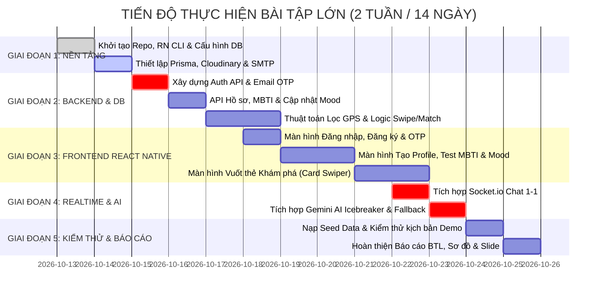

# KẾ HOẠCH TRIỂN KHAI DỰ ÁN 2 TUẦN (WBS & SPRINT TIMELINE)
## DỰ ÁN: SMART DATING APP (CUPID AI) - BÀI TẬP LỚN
**Thời lượng:** 14 Ngày (2 Tuần)  
**Vai trò:** Senior Project Manager & Scrum Master  
**Mục tiêu:** Bàn giao sản phẩm hoạt động hoàn chỉnh, mã nguồn chuẩn mực và trọn bộ tài liệu báo cáo học thuật.

---

## 1. CẤU TRÚC PHÂN RÃ CÔNG VIỆC (WORK BREAKDOWN STRUCTURE - WBS)

Dự án được phân rã thành 6 gói công việc (Work Packages - WP) từ cấp 1 đến cấp 3:

```
WP 1.0: KHỞI TẠO & KIẾN TRÚC NỀN TẢNG (Foundation & Setup)
  ├─ 1.1 Khởi tạo Repository & Cấu trúc thư mục (Monorepo/Polyrepo FE & BE)
  ├─ 1.2 Thiết lập PostgreSQL Database & Prisma ORM Schema
  ├─ 1.3 Cấu hình Cloudinary (Media CDN) & Nodemailer SMTP (Email OTP)
  └─ 1.4 Khởi tạo dự án Mobile React Native CLI (với TypeScript Template) & Cấu hình Navigation

WP 2.0: PHÁT TRIỂN BACKEND API & DỊCH VỤ CỐT LÕI (Backend Core Services)
  ├─ 2.1 Module Auth: Đăng ký, Mã hóa mật khẩu, Gửi & Xác thực Email OTP, JWT Token
  ├─ 2.2 Module Profile: CRUD Hồ sơ cá nhân, Upload ảnh lên Cloudinary
  ├─ 2.3 Module MBTI & Mood: API lưu kết quả trắc nghiệm và cập nhật nhãn tâm trạng
  ├─ 2.4 Module Discovery: Thuật toán lọc ứng viên theo bán kính GPS (Haversine Formula)
  └─ 2.5 Module Matching: Xử lý thao tác Swipe (Like/Pass) và logic kích hoạt Match

WP 3.0: PHÁT TRIỂN GIAO DIỆN DI ĐỘNG (Frontend React Native Screens)
  ├─ 3.1 Màn hình Auth: Đăng nhập, Đăng ký, Nhập mã xác thực OTP 6 số
  ├─ 3.2 Màn hình Onboarding: Nhập thông tin, Chọn ảnh đại diện, Thẻ sở thích
  ├─ 3.3 Màn hình Trắc nghiệm MBTI: Giao diện làm bài test 12 câu trắc nghiệm trực quan
  ├─ 3.4 Màn hình Khám phá (Discover): Vuốt thẻ mượt mà (Card Swiper), Xem chi tiết hồ sơ
  ├─ 3.5 Màn hình Cài đặt & Vị trí: Chuyển đổi giữa GPS máy thật (@react-native-community/geolocation) và GPS giả lập để demo
  └─ 3.6 Màn hình Danh sách Match & Hội thoại

WP 4.0: TÍCH HỢP REAL-TIME & TỰ ĐỘNG HÓA AI (Real-time & AI Integration)
  ├─ 4.1 Cấu hình Socket.io Server & Client: Quản lý phòng chat, Trạng thái online, Typing
  ├─ 4.2 Giao diện Chat 1-1: Bong bóng chat, Lịch sử tin nhắn tức thời
  ├─ 4.3 Tích hợp Google Gemini 1.5 Flash API: Prompt Engineering & Schema Validation
  ├─ 4.4 Giao diện AI Icebreaker: Bottom Sheet hiển thị 3 phong cách câu mở lời, Chạm để fill
  └─ 4.5 Xây dựng cơ chế Fallback xử lý ngoại lệ khi mất kết nối mạng AI

WP 5.0: KIỂM THỬ, TỐI ƯU & KỊCH BẢN DEMO (Testing & Demo Polish)
  ├─ 5.1 Kiểm thử luồng nghiệp vụ E2E (End-to-End Testing): Đăng ký -> Vuốt -> Match -> Chat
  ├─ 5.2 Xây dựng dữ liệu mẫu (Seed Data): 20 hồ sơ sinh viên với đầy đủ ảnh, MBTI, Mood
  ├─ 5.3 Tối ưu hiệu năng: Tốc độ tải thẻ vuốt 60 FPS, độ trễ tin nhắn < 100ms
  └─ 5.4 Chuẩn bị kịch bản Demo trực tiếp trên 2 thiết bị (hoặc 1 máy thật + 1 máy ảo Android Emulator)

WP 6.0: HOÀN THIỆN TÀI LIỆU HỌC THUẬT & BÁO CÁO (Documentation & Handover)
  ├─ 6.1 Tổng hợp Báo cáo BTL (Word/PDF): Bối cảnh, Kiến trúc, Thiết kế CSDL, Kết quả
  ├─ 6.2 Xuất trọn bộ sơ đồ kỹ thuật chất lượng cao (Kiến trúc, Use Case, ERD, Sequence, Activity)
  ├─ 6.3 Xây dựng Slide thuyết trình bảo vệ đồ án (PowerPoint / Canva)
  └─ 6.4 Hướng dẫn cài đặt và triển khai mã nguồn (README.md chi tiết từng bước)
```

---

## 2. LỊCH TRÌNH TIẾN ĐỘ 14 NGÀY (SPRINT GANTT TIMELINE)



---

## 3. CHI TIẾT TỪNG NGÀY VÀ ĐẦU RA BÀN GIAO (DAY-BY-DAY DELIVERABLES)

| Ngày | Mục tiêu chính trong ngày | Đầu việc cụ thể (Tasks) | Kết quả bàn giao (Deliverables) |
| :---: | :--- | :--- | :--- |
| **Ngày 1** | Khởi tạo cấu trúc dự án | - Init Backend Node.js TypeScript (Express).<br>- Init Frontend React Native CLI (`npx @react-native-community/cli init CupidApp`).<br>- Cấu hình ESLint, Prettier, Git repository. | Mã nguồn khung 2 thư mục `backend` và `frontend` build thành công trên Android Studio Emulator. |
| **Ngày 2** | Thiết lập CSDL & Dịch vụ ngoài | - Viết `schema.prisma` và migrate lên PostgreSQL local/cloud.<br>- Đăng ký tài khoản Cloudinary Free Tier.<br>- Cấu hình tài khoản SMTP gửi mail miễn phí. | Database đã sinh đầy đủ bảng; script upload ảnh test thành công lên Cloudinary. |
| **Ngày 3** | Xây dựng Module Xác thực (Auth) | - Viết API Đăng ký, Đăng nhập, Refresh Token.<br>- Viết hàm sinh OTP và gửi email kích hoạt tài khoản.<br>- Viết Middleware xác thực JWT Bearer Token. | Bộ API Auth hoàn chỉnh test thành công trên Postman (đăng ký -> nhận email OTP -> đăng nhập). |
| **Ngày 4** | Xây dựng API Profile & MBTI | - Viết API tạo/sửa hồ sơ, upload mảng ảnh.<br>- Viết logic trắc nghiệm MBTI và lưu mã tính cách.<br>- Viết API cập nhật nhãn Mood (hết hạn sau 24h). | Postman Collection kiểm thử đầy đủ các chức năng hồ sơ người dùng. |
| **Ngày 5-6**| Xây dựng Engine Ghép đôi & GPS | - Viết công thức Haversine tính khoảng cách tọa độ.<br>- Viết API lấy Feed thẻ theo bán kính và độ tuổi.<br>- Viết API Swipe: Kiểm tra điều kiện Match 2 chiều. | Cơ chế Match hoạt động hoàn hảo trong database khi 2 user Like lẫn nhau. |
| **Ngày 7** | Giao diện Mobile: Auth & OTP | - Dựng UI màn hình Login, Register.<br>- Dựng giao diện 6 ô nhập mã OTP tự động focus.<br>- Quản lý lưu trữ Token an toàn (`@react-native-async-storage/async-storage`). | Người dùng có thể đăng ký, nhận OTP qua email và đăng nhập trên điện thoại thật. |
| **Ngày 8-9**| Giao diện Mobile: Profile & MBTI | - Dựng form Onboarding điền thông tin cá nhân.<br>- Thư viện chọn ảnh (`react-native-image-picker`).<br>- Giao diện làm trắc nghiệm MBTI 12 câu hỏi trực quan. | Luồng tạo tài khoản hoàn chỉnh từ con số 0 đến khi có hồ sơ đẹp mắt. |
| **Ngày 10** | Giao diện Mobile: Vuốt thẻ Khám phá| - Tích hợp thư viện vuốt thẻ (`react-native-deck-swiper` hoặc Reanimated).<br>- Hiển thị thẻ người dùng: Ảnh, Tên, Tuổi, MBTI, Mood tag, Khoảng cách.<br>- Popup chúc mừng Match rực rỡ khi ghép đôi thành công. | Trải nghiệm vuốt thẻ mượt mà đạt chuẩn 60 khung hình/giây. |
| **Ngày 11** | Tích hợp Chat Real-time Socket.io | - Dựng Socket Server quản lý phòng chat theo `matchId`.<br>- Dựng màn hình Chat 1-1 trên Mobile (tin nhắn đi, tin nhắn đến, mốc thời gian).<br>- Sự kiện gõ phím (`isTyping`). | 2 điện thoại có thể nhắn tin tức thời cho nhau trong vòng dưới 100ms. |
| **Ngày 12** | Tích hợp Trợ lý AI Icebreaker | - Viết service gọi Google Gemini 1.5 Flash API.<br>- Dựng Bottom Sheet gợi ý 3 phong cách mở lời.<br>- Cơ chế chạm để điền tự động vào ô nhập tin nhắn.<br>- Viết bộ Fallback xử lý khi mất mạng AI. | Tính năng "ngôi sao" AI hoạt động trơn tru, sinh câu mở lời tiếng Việt cực kỳ dí dỏm. |
| **Ngày 13** | Nạp dữ liệu & Tổng duyệt kịch bản| - Chạy kịch bản nạp sẵn 20 tài khoản mẫu sinh viên.<br>- Kiểm thử kịch bản demo: 2 tài khoản đổi tọa độ GPS giả lập, vuốt match nhau và dùng AI mở lời.<br>- Tinh chỉnh giao diện và sửa toàn bộ lỗi nhỏ. | Bản build ứng dụng ổn định 100%, không xảy ra crash hay đơ màn hình khi demo. |
| **Ngày 14** | Hoàn thiện Báo cáo BTL & Slide | - Biên tập toàn bộ tài liệu thành báo cáo thuyết minh BTL.<br>- Chèn đầy đủ sơ đồ kiến trúc, CSDL, Use Case.<br>- Hoàn thiện Slide thuyết trình bảo vệ trước hội đồng. | Bộ hồ sơ nghiệm thu hoàn chỉnh sẵn sàng nộp và thuyết trình đạt điểm tối đa. |

---

## 4. MA TRẬN PHÂN BỔ TRÁCH NHIỆM (RACI MATRIX)

| Đầu việc | Solution Architect & PM | Backend Developer | Mobile RN Developer | QA & Tester |
| :--- | :---: | :---: | :---: | :---: |
| Thiết kế Kiến trúc & Lược đồ CSDL | **A / R** | C | C | I |
| Xây dựng RESTful API & Socket.io | A | **R** | C | I |
| Xây dựng Ứng dụng Mobile React Native | A | C | **R** | I |
| Tích hợp Prompt Engineering Google Gemini | **A / R** | **R** | C | I |
| Kiểm thử kịch bản Demo & Viết Test Cases | A | C | C | **R** |
| Soạn thảo Báo cáo BTL & Vẽ sơ đồ kỹ thuật | **A / R** | C | C | I |

*(Chú thích: **R** = Responsible - Người thực hiện; **A** = Accountable - Người chịu trách nhiệm chính; **C** = Consulted - Người tham vấn; **I** = Informed - Người nhận thông tin)*

---

## 5. ĐỊNH NGHĨA HOÀN THÀNH (DEFINITION OF DONE - DOD)
Một tính năng chỉ được xem là hoàn thành và sẵn sàng demo khi đáp ứng đủ 4 tiêu chí:
1. **Code Complete:** Mã nguồn tuân thủ TypeScript, không có lỗi cú pháp hoặc cảnh báo nghiêm trọng.
2. **API Verified:** Endpoint được kiểm thử độc lập qua Postman thành công với cả dữ liệu hợp lệ và không hợp lệ.
3. **UI Responsive:** Giao diện hiển thị đúng trên cả màn hình nhỏ (iPhone SE/Android nhỏ) và màn hình lớn, không bị tràn viền hay vỡ font.
4. **Documented:** Được cập nhật vào tài liệu báo cáo kỹ thuật và có chú thích code rõ ràng.
